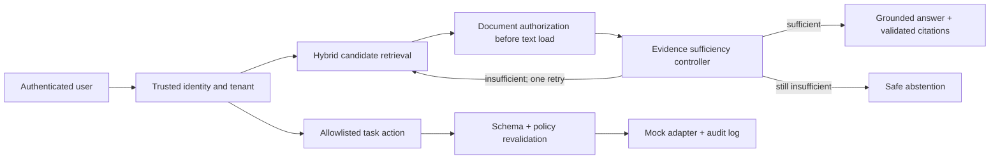

# Entrix AI

Entrix AI is a compact research prototype for permission-conditioned enterprise RAG and bounded enterprise task actions. Its core question is whether the evidence a user is authorized to see is sufficient to answer safely. It is not production-ready and its synthetic evaluation is not a benchmark result.



## Run locally

The simplest route is one terminal from the repository root:

```powershell
python run.py --install  # first run only
python run.py
```

Open `http://127.0.0.1:5173`; Ctrl+C stops both the API and frontend. The launcher seeds demo data only if the local database has no users. Use `python run.py --no-seed` to start without demo data.

Manual commands remain available:

Prerequisites: Python 3.11+ and Node 20+. From `backend`, install the Python project, apply the migration, and seed the clearly synthetic demo data:

```powershell
cd backend
python -m pip install -e ".[dev]"
alembic -c alembic.ini upgrade head
python ..\scripts\seed_demo.py
uvicorn app.main:app --reload
```

From `frontend` in a second terminal:

```powershell
npm install
npm run build
npm run dev
```

Open `http://localhost:5173`. All demo users use password `password`; demo identity selection is not production authentication. SQLite plus in-memory Qdrant is the default local configuration. To use Qdrant/ PostgreSQL services, set `QDRANT_IN_MEMORY=false` and a PostgreSQL async URL. The supplied `docker-compose.yml` starts those services.

## Checks and evaluation

```powershell
cd backend
python -m pytest
python -m ruff check app tests
python ..\scripts\run_evaluation.py --output-dir ..\experiments\results\software_validation
```

The runner exports JSONL per-query files and aggregate JSON. It uses an intentionally synthetic fixture and does not claim general performance. Research artifacts and the verified literature matrix are in `paper/`.

## Security model and limitations

The backend resolves organization and role from persisted identity, not frontend claims. It scopes dense and lexical retrieval by tenant, checks each candidate document before chunk text is loaded, validates citations against the authorized evidence set, and limits retries to one. Actions are allowlisted, schema-validated, revalidated against current identity/policy, tenant-scoped, idempotent per actor/tenant, and audited without document text or secrets.

The application uses a deterministic hashing embedding backend for fully offline demos/tests; set `EMBEDDING_BACKEND=sentence_transformer` only where a local model cache or model download is permitted. Development schema creation is enabled by default for convenience; set `AUTO_CREATE_SCHEMA=false` in non-development environments and run Alembic. No real SSO, production task API, uploaded PDF extraction, or formal benchmark dataset is included.
